# 🛡️ SecureHex 2.0 (Python Tkinter GUI & SQLite Edition)

<div align="center">

[](https://www.python.org/)
[](https://docs.python.org/3/library/tkinter.html)
[](https://www.sqlite.org/)
[](https://cryptography.io/)
[-2EA043?style=for-the-badge&logo=pytest&logoColor=white)](https://docs.pytest.org/)
[](https://www.srmist.edu.in/)

**Enterprise-Grade Desktop Credential Management System**  
*Developed for 21CSC203P – Advanced Programming Practice (Professional Core)*  
*SRM Institute of Science and Technology, Kattankulathur*

</div>

---

## 📖 1. Project Overview

**SecureHex** is a multi-paradigm, desktop-grade credential and secret management suite engineered in **Python 3** using **Tkinter/TTK GUI** and a declarative **SQLite 3** relational persistence engine.

Engineered specifically to satisfy the rigorous theoretical and practical syllabus of **21CSC203P (Advanced Programming Practice)**, SecureHex demonstrates the full software engineering lifecycle by uniting:
- **Military-Grade Authenticated Cryptography:** Symmetric **AES-256-GCM** (Galois/Counter Mode) with tamper-detection authentication tags and per-record CSPRNG 12-byte initialization vectors (IV).
- **Hardened Authentication:** Salted **SHA-256** password hashing with 128-bit random salts and constant-time string verification (`hmac.compare_digest`) immune to timing side-channel attacks.
- **Declarative Relational Persistence:** **SQLite 3** relational schema with Foreign Keys, indexed lookups, and parameterized Prepared Statements eliminating SQL Injection risks.
- **Concurrent Programming (Multithreading):** Background daemon thread for user inactivity auto-lock and asynchronous background auditor worker for vault hygiene inspection.
- **Formal Language Automata:** A theoretical 5-tuple **Deterministic Finite Automaton (DFA)** $M = (Q, \Sigma, \delta, q_0, F)$ calculating real-time password complexity with a dynamic canvas meter.
- **Modern Cyber UI/UX:** A bespoke **Hex-Dark cybersecurity theme** (`#0D1117`) featuring real-time search, category filtering, password generator with Shannon entropy metrics, and automatic **30-second clipboard memory wiping**.

---

## 👥 2. Academic Team Distribution (Group of 3)

| Team Member | Project Role | Modules Owned & Theoretical Paradigms Demonstrated |
| :--- | :--- | :--- |
| **Sujoy Behera (Lead)** | **Core Domain & Security Lead** | • OOP Class Hierarchy (`Credential`, `WebCredential`, `CardCredential`, `SecureNote`)<br>• Marker Protocol (`Auditable`) & Polymorphic Dynamic Method Dispatch<br>• Cryptographic Engine (`EncryptionService` AES-256-GCM, `PasswordHasher` SHA-256, Shannon Entropy calculation) |
| **Member 2** | **Concurrency & Database Lead** | • Declarative SQLite 3 Persistence (`DatabaseManager`, `UserDAO`, `CredentialDAO`)<br>• Schema DDL, transactional rollbacks, indexing, and parameterized queries<br>• Multithreading: Daemon Inactivity Auto-Lock Thread (`AutoLockManager`) |
| **Member 3** | **Tkinter GUI & Automata Lead** | • Tkinter MVC Architecture (`SecureHexApp`, `LoginRegisterFrame`, `DashboardFrame`, `HexDarkTheme`)<br>• Event-Driven Programming (`<KeyRelease>`, `<Motion>`, `<Return>`, `<Double-1>`)<br>• Formal Language Automata: Deterministic Finite Automaton (`PasswordDFA`, `DFAState`, `PasswordStrengthMeter`) |

---

## 🧩 3. Syllabus Paradigm Mapping (21CSC203P)

| Unit | Syllabus Concept | Concrete Implementation in SecureHex |
| :--- | :--- | :--- |
| **Unit 1: Foundations** | Structured Programming & Shannon Entropy | • Bohm-Jacopini sequence/selection/iteration constructs in `PasswordGenerator`<br>• Information-theoretic Shannon Entropy calculation $E = L \times \log_2(R)$ bits<br>• Dynamic CSPRNG memory allocation (`os.urandom`) and secure JSON backup export |
| **Unit 2: Object-Oriented Paradigm** | Abstraction, Encapsulation, Inheritance, Polymorphism, Tagging Protocol | • `securehex.models.Credential` abstract base class with encapsulated private fields<br>• Subclass polymorphism with runtime dispatch (`get_summary()`, `get_masked_details()`, `get_primary_secret()`)<br>• Tagging (Marker) Protocol: `securehex.models.Auditable` |
| **Unit 3: Concurrent Programming** | Multithreading, Daemons & Thread Safety | • **Inactivity Daemon:** Background daemon thread `AutoLockManager` monitoring user keyboard/mouse events and locking the vault without blocking UI responsiveness<br>• **Asynchronous Worker:** `SecurityAuditorThread` inspecting passwords for reuse and complexity in the background |
| **Unit 3: Declarative Database** | Relational Persistence & SQL Transactions | • Zero-config **SQLite 3** (`securehex.db`) with Foreign Keys, indexed lookups, and auto-migration<br>• Parameterized query execution (`?` placeholders) completely eliminating SQL injection<br>• Clean Data Access Object (DAO) architecture: `DatabaseManager`, `UserDAO`, `CredentialDAO` |
| **Unit 3: GUI Paradigm** | Desktop MVC Architecture & Event Handling | • Clean Model-View-Controller separation built on **Tkinter** and `ttk`<br>• Modern Hex Dark UI (`HexDarkTheme`) with `ttk.Treeview`, live search filter, modal dialogs, and 30s clipboard auto-clear |
| **Unit 5: Formal Automata** | Finite Automata (DFA State Machine) | • Formal 5-tuple machine $M = (Q, \Sigma, \delta, q_0, F)$ in `PasswordDFA`<br>• Real-time state transitions across $\{Q_{START}, Q_{SHORT}, Q_{WEAK}, Q_{MODERATE}, Q_{STRONG}, Q_{EXCELLENT}\}$<br>• Dynamic canvas meter rendering state colors and actionable feedback |

---

## 🏛️ 4. System Architecture

```mermaid
flowchart TD
    subgraph UI["Unit 3: Desktop Tkinter GUI (MVC)"]
        App["SecureHexApp (Root Controller)"]
        Login["LoginRegisterFrame (Cards & Attempt Limiter)"]
        Dash["DashboardFrame (Vault & Treeview)"]
        AddModal["AddCredentialDialog (Polymorphic Form)"]
        GenModal["PasswordGeneratorDialog (Entropy Slider)"]
        AuditModal["SecurityAuditDialog (Hygiene Report)"]
        Meter["PasswordStrengthMeter (Live Canvas)"]
    end

    subgraph Automata["Unit 5: Formal Automata Paradigm"]
        DFA["PasswordDFA Machine M = (Q, Σ, δ, q0, F)"]
        DFAStates["DFAState Enum (START, SHORT, WEAK, MODERATE, STRONG, EXCELLENT)"]
    end

    subgraph Domain["Unit 2: OOP Domain Hierarchy"]
        Auditable["«Protocol» Auditable"]
        CredBase["«Abstract» Credential"]
        WebCred["WebCredential"]
        CardCred["CardCredential"]
        NoteCred["SecureNote"]
        User["User Entity"]
    end

    subgraph Security["Unit 1: Cryptographic Engine"]
        AES["EncryptionService (AES-256-GCM + CSPRNG IV)"]
        Hasher["PasswordHasher (SHA-256 + Salt + Constant-Time Verify)"]
        Gen["PasswordGenerator (CSPRNG + Shannon Entropy)"]
    end

    subgraph Concurrency["Unit 3: Concurrent Programming"]
        AutoLock["AutoLockManager (Daemon Thread - 180s Inactivity)"]
        Auditor["SecurityAuditorThread (Worker Thread - Async Inspection)"]
    end

    subgraph DB["Unit 3: Declarative Relational Persistence"]
        DBMgr["DatabaseManager (SQLite Connection & Migration)"]
        UserDAO["UserDAO (User CRUD & Auth)"]
        CredDAO["CredentialDAO (Polymorphic Persistence)"]
        SQLite[("SQLite 3 Database (securehex.db)")]
    end

    App --> Login
    App --> Dash
    Login --> Hasher
    Login --> UserDAO
    Login --> Meter
    Meter --> DFA
    DFA --> DFAStates
    Dash --> AutoLock
    Dash --> Auditor
    Dash --> CredDAO
    Dash --> AddModal
    Dash --> GenModal
    Auditor --> AuditModal
    AddModal --> AES
    AddModal --> CredBase
    CredBase --> WebCred
    CredBase --> CardCred
    CredBase --> NoteCred
    CredBase -.-> Auditable
    UserDAO --> DBMgr
    CredDAO --> DBMgr
    DBMgr --> SQLite
```



---

## 🗄️ 5. SQLite 3 Database Schema (DDL)

The relational engine operates declaratively on `securehex.db` with strict foreign key constraints and indexed queries:

```sql
-- 1. Users Account Table
CREATE TABLE IF NOT EXISTS users (
    id INTEGER PRIMARY KEY AUTOINCREMENT,
    name TEXT NOT NULL,
    email TEXT NOT NULL UNIQUE,
    password_hash TEXT NOT NULL,
    salt TEXT NOT NULL,
    created_at TEXT NOT NULL,
    last_login TEXT NOT NULL
);

-- 2. Polymorphic Encrypted Credentials Table
CREATE TABLE IF NOT EXISTS credentials (
    id TEXT PRIMARY KEY,
    user_id INTEGER NOT NULL,
    title TEXT NOT NULL,
    category TEXT NOT NULL,
    field1 TEXT,                     -- Web: URL | Card: Cardholder Name
    field2 TEXT,                     -- Web: Username | Card: Expiry Date
    secret_data TEXT NOT NULL,       -- AES-256-GCM Encrypted Secret (Password / Card Number / Note)
    extra_data TEXT,                 -- Card: CVV (Encrypted) | Note: Tags
    created_at TEXT NOT NULL,
    last_modified TEXT NOT NULL,
    FOREIGN KEY (user_id) REFERENCES users(id) ON DELETE CASCADE
);

-- Performance Indexes
CREATE INDEX IF NOT EXISTS idx_credentials_user ON credentials(user_id);
CREATE INDEX IF NOT EXISTS idx_credentials_cat ON credentials(category);
```

---

## 🖥️ 6. User Interface Layout & Visual Design

The user interface implements a cybersecurity-tailored **Hex-Dark Theme**:
- Canvas Background: `#0D1117`
- Card Panels: `#161B22`
- Input Fields: `#21262D`
- Accent Neon Green: `#2EA043`
- Action Blue: `#58A6FF`
- Danger Red: `#F85149`
- Amber Warning: `#D29922`

```
+---------------------------------------------------------------------------------------+
| 🛡️ SecureHex Vault • Logged in as: Sujoy Behera (sujoy@srmist.edu.in)    ⏳ Auto-Lock: 178s  🔒 Lock  🚪 Logout |
+---------------------------------------------------------------------------------------+
|  [ Total Items: 12 ]    [ Web Logins: 7 ]    [ Payment Cards: 3 ]    [ Secure Notes: 2 ]   |
+---------------------------------------------------------------------------------------+
| 🔍 Search: [ github___________ ]   Category: [ All Categories ▼ ]                     |
+---------------------------------------------------------------------------------------+
| Type            | Title / Service  | Account / Resource Details      | Masked Secret | Last Modified      |
|-----------------|------------------|---------------------------------|---------------|--------------------|
| Web Login       | GitHub Account   | User: sujoy | URL: github.com   | ••••••••      | 2026-10-30 10:20   |
| Credit/Debit    | HDFC Regalia     | Holder: Sujoy | Exp: 12/28      | ••••••••      | 2026-10-30 09:45   |
| Secure Note     | Server SSH Keys  | Tags: [devops, cloud, srm]      | ••••••••      | 2026-10-29 18:12   |
+---------------------------------------------------------------------------------------+
| [➕ Add Item]  [📋 Copy Secret]  [👁️ Reveal]  [✏️ Edit]  [🗑️ Delete]  [⚡ Password Generator] |
|                                             [💾 Backup JSON]  [🛡️ Run Security Audit (Async)] |
+---------------------------------------------------------------------------------------+
```

---

## 🔒 7. Cryptographic & Security Engineering

### 1. AES-256-GCM Authenticated Encryption
- Authenticated Encryption with Associated Data (AEAD) provides both **confidentiality** and **authenticity**.
- Each encryption operation generates a unique, cryptographically random **12-byte Initialization Vector (IV)** via `os.urandom`.
- Produces a **128-bit authentication tag**; any unauthorized bit modification in SQLite immediately causes decryption rejection.

### 2. Salted SHA-256 Password Hashing & Timing-Attack Immunity
- Master passwords are never stored in plaintext or raw hash form.
- A 16-byte random salt is prepended before hashing with SHA-256 to neutralize rainbow tables.
- Password verification utilizes Python's standard `hmac.compare_digest` executing in constant time, preventing timing-based side-channel attacks.

### 3. Inactivity Auto-Lock Daemon
- An independent background daemon thread (`AutoLockManager`) monitors user interaction.
- Any mouse motion, keypress, or click resets the idle counter.
- Exceeding the inactivity threshold (default: 180 seconds) triggers an auto-lock callback that safely unloads decrypted secrets from RAM and returns to the authentication screen.

### 4. 30-Second Clipboard Sanitization
- Whenever a user clicks **"📋 Copy Secret"**, the plaintext is placed onto the system clipboard and a single-shot timer is initiated.
- After **30 seconds**, the clipboard is automatically purged, preventing unauthorized snooping by other desktop processes.

### 5. Brute-Force Lockout Defense
- Sign-in attempts are tracked with a strict **5-attempt threshold**.
- Exceeding maximum failed attempts locks the login interface to thwart brute-force password guessing.

---

## 📦 8. Project Structure

```
SecureHex/
├── securehex/                                # Core Application Package
│   ├── automata/                             # Unit 5: Formal Automata Theory
│   │   ├── __init__.py
│   │   ├── dfa_state.py                      # DFA State enumerations & colors
│   │   └── password_dfa.py                   # 5-tuple DFA state transition machine
│   ├── concurrency/                          # Unit 3: Concurrent Programming
│   │   ├── __init__.py
│   │   ├── autolock.py                       # Inactivity auto-lock daemon thread
│   │   └── security_auditor.py               # Asynchronous vault auditor worker thread
│   ├── database/                             # Unit 3: Declarative SQLite Persistence
│   │   ├── __init__.py
│   │   ├── db_manager.py                     # SQLite connection manager & schema DDL
│   │   ├── user_dao.py                       # User entity Data Access Object
│   │   └── credential_dao.py                 # Polymorphic credential Data Access Object
│   ├── gui/                                  # Unit 3: Tkinter Desktop GUI (MVC)
│   │   ├── __init__.py
│   │   ├── theme.py                          # Hex-Dark cyber theme styling
│   │   ├── password_meter.py                 # Dynamic DFA canvas progress meter
│   │   ├── login_frame.py                    # Sign In / Register tabs & attempt limiter
│   │   ├── add_dialog.py                     # Polymorphic Add/Edit modal dialog
│   │   ├── generator_dialog.py               # Interactive password generator with entropy
│   │   ├── audit_dialog.py                   # Multithreaded security audit report modal
│   │   ├── dashboard_frame.py                # Vault dashboard & Treeview table
│   │   └── app_window.py                     # Root window controller & screen switcher
│   ├── models/                               # Unit 2: Object-Oriented Domain Hierarchy
│   │   ├── __init__.py
│   │   ├── credential.py                     # Abstract Credential & Auditable protocol
│   │   └── user.py                           # Encapsulated User domain model
│   └── security/                             # Unit 1 & Unit 2: Cryptographic Engine
│       ├── __init__.py
│       ├── encryption.py                     # AES-256-GCM authenticated encryption
│       ├── hasher.py                         # Salted SHA-256 hashing & constant-time verify
│       └── generator.py                      # Procedural password generator & Shannon entropy
├── tests/
│   └── test_securehex.py                     # Automated Pytest suite (13 test cases)
├── main.py                                   # Application Launcher (GUI & CLI fallback)
├── requirements.txt                          # Python dependencies
├── README.md                                 # Technical documentation
└── .gitignore                                # Version control ignore rules
```

---

## 🚀 9. How to Install & Run

### Prerequisites
- Python 3.10 or higher (Python 3.12 recommended)
- `tkinter` (included with standard Python on Windows/macOS)

### 1. Clone the Repository
```powershell
git clone https://github.com/SujoyBehera/SecureHex.git
cd SecureHex
```

### 2. Install Dependencies
```powershell
pip install -r requirements.txt
```

### 3. Launch Desktop GUI Application
```powershell
python main.py
```

### 4. Launch Interactive CLI Demonstration Mode (Optional)
For headless environments or quick terminal-based grading:
```powershell
python main.py --cli
```

### 5. Run the Automated Pytest Suite
```powershell
python -m pytest tests/test_securehex.py -v
```

**Test Verification Summary (100% Pass):**
```text
tests/test_securehex.py::TestSecurity::test_hasher_matches_and_rejects_wrong_password PASSED
tests/test_securehex.py::TestSecurity::test_aes_256_gcm_encrypt_decrypt_integrity PASSED
tests/test_securehex.py::TestSecurity::test_aes_decrypt_fails_with_wrong_key PASSED
tests/test_securehex.py::TestSecurity::test_password_generator_entropy_and_diversity PASSED
tests/test_securehex.py::TestAutomataDFA::test_empty_password_transition PASSED
tests/test_securehex.py::TestAutomataDFA::test_short_password_transition PASSED
tests/test_securehex.py::TestAutomataDFA::test_weak_password_transition PASSED
tests/test_securehex.py::TestAutomataDFA::test_moderate_password_transition PASSED
tests/test_securehex.py::TestAutomataDFA::test_strong_and_excellent_transitions PASSED
tests/test_securehex.py::TestDatabaseDAO::test_user_creation_and_lookup PASSED
tests/test_securehex.py::TestDatabaseDAO::test_polymorphic_credential_crud PASSED
tests/test_securehex.py::TestConcurrency::test_autolock_manager_countdown_and_trigger PASSED
tests/test_securehex.py::TestConcurrency::test_security_auditor_worker_thread PASSED

============================= 13 passed in 1.51s ==============================
```

---

## 👨‍💻 10. Developer & Course Attribution

- **Lead Developer:** Sujoy Behera
- **Degree:** B.Tech Computer Science and Engineering
- **Institution:** SRM Institute of Science and Technology, Kattankulathur
- **Course:** 21CSC203P – Advanced Programming Practice (APP)
- **Year:** 2026
